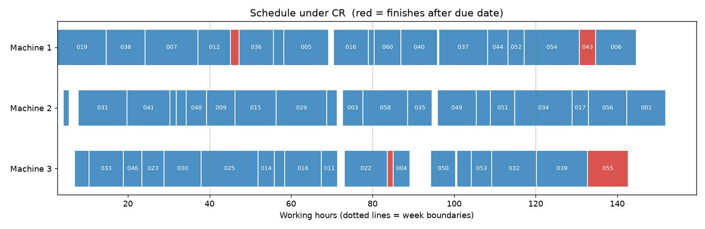

# Scheduling & Capacity Planning

A small pipeline that generates a fake set of production jobs, validates it, and works out
how to sequence the orders across your machines (or crews) to hit due dates and cut idle
time — writing the input data, the schedules and a Gantt chart into a single Excel workbook.

It connects two earlier topics: *staffing* decided how many people you need, and
*demand forecasting* predicted how much work is coming. This asks the next question —
given that work and those machines, **in what order should the jobs run, and do you have
enough capacity?**

The scheduling approach is a discrete-event simulation of a shop floor. Whenever a machine
becomes free it picks the next job from the queue using a **dispatching rule**; the tool runs the
same jobs under six rules and compares them:

| Rule | Picks the waiting job with… | Tends to be good at |
| --- | --- | --- |
| **FIFO** | the earliest release time | fairness / the "do nothing clever" baseline |
| **SPT** | the shortest processing time | low average flow time, short queues |
| **EDD** | the earliest due date | minimising the worst lateness |
| **SLACK** | the least slack (`due − now − processing`) | rescuing tight jobs |
| **CR** | the lowest critical ratio (`(due − now) / processing`) | cutting total tardiness |
| **WSPT** | the highest order value per processing hour | prioritising revenue |

Metrics reported per rule: **makespan**, **total / max tardiness**, **late jobs**, **on-time %**,
**average flow time**, **idle hours** and **machine utilization**. The best rule is the one with the
lowest total tardiness (ties broken by makespan).

> Jobs are non-preemptive on identical parallel machines, with release times and due dates, all on
> one working-hour clock. Real shops add set-up times, machine skills and shift calendars — this is
> the core logic you would extend.

## How it works

Three scripts, run in order, each consuming the previous one's output:

1. **`generate_data.py`** — uses [Faker](https://faker.readthedocs.io/) to create a fake
   dataset of jobs (customer, product family, processing hours, release time, due date, order value)
   and writes it to `data/jobs_raw.csv`. Processing times are scaled to fill ~90% of your machine
   hours so that sequencing actually matters. A small percentage of rows are deliberately corrupted
   (negative hours, impossible due dates, blanks, a duplicate job ID) so the next step has real errors to catch.
2. **`validate_data.py`** — checks every row in `data/jobs_raw.csv` against the schema in
   `scheduling_common.py` (via [pydantic](https://docs.pydantic.dev/)), drops invalid or
   duplicate rows, and writes:
   - `data/jobs_validated.csv` — the clean rows
   - `data/validation_report.txt` — what was rejected and why
3. **`analyze_schedule.py`** — reads `data/jobs_validated.csv`, simulates every rule, and writes a new
   `output/schedule_analysis.xlsx` workbook (plus `output/gantt.png`) with seven sheets:
   - **Input Data** — the validated records the analysis ran on
   - **Rule Comparison** — the six rules ranked, best one highlighted
   - **Best Schedule** — job-by-job machine, start/end time, wait and lateness (late jobs highlighted)
   - **Machine Summary** — busy hours, idle hours and utilization per machine
   - **Capacity Plan** — lateness and utilization as you add or remove machines
   - **Weekly Load** — work released each week vs. capacity (weeks over 100% are flagged)
   - **Gantt** — the best schedule as a chart, late jobs in red

`scheduling_common.py` holds the shared data model and file paths used by all three scripts.

> **Example Results** : [sample_results.xlsx](./sample_results.xlsx)
>
> 

## Setup

### 1. Get the code

```powershell
git clone <your-repo-url>
cd Scheduling-capacity-planning
```

### 2. Create and activate a virtual environment

**Windows (PowerShell):**

```powershell
python -m venv .venv
.venv\Scripts\Activate.ps1
```

**macOS / Linux:**

```bash
python3 -m venv .venv
source .venv/bin/activate
```

### 3. Install dependencies

```powershell
pip install -r requirements.txt
```

Requires Python 3.10+ (uses PEP 604 type hints). The simulation itself is pure standard library;
`matplotlib` is only used for the Gantt chart.

## Usage

Run the three scripts in order from the project root, with the virtual environment
activated:

```powershell
python generate_data.py --count 60 --error-rate 0.05 --seed 42
python validate_data.py
python analyze_schedule.py --machines 3
```

Then open `output/schedule_analysis.xlsx`.

### Options

| Script | Flag | Default | Description |
| --- | --- | --- | --- |
| `generate_data.py` | `--count` | `60` | Number of fake jobs to generate |
| | `--error-rate` | `0.05` | Fraction of rows to deliberately corrupt (`0` for a perfectly clean dataset) |
| | `--machines` | `3` | Machines the generated load is sized for |
| | `--weeks` | `4` | Planning horizon in 40-hour weeks |
| | `--target-load` | `0.9` | Share of total machine hours the jobs should fill |
| | `--seed` | none | Random seed, for reproducible output |
| | `--output` | `data/jobs_raw.csv` | Where to write the raw data |
| `validate_data.py` | `--input` | `data/jobs_raw.csv` | File to validate |
| | `--output` | `data/jobs_validated.csv` | Where to write the cleaned data |
| | `--report` | `data/validation_report.txt` | Where to write the rejection report |
| `analyze_schedule.py` | `--input` | `data/jobs_validated.csv` | File to analyze |
| | `--output` | `output/schedule_analysis.xlsx` | Where to write the results workbook |
| | `--gantt` | `output/gantt.png` | Where to write the Gantt chart |
| | `--machines` | `3` | Machines / crews you actually have |
| | `--max-machines` | `machines + 3` | Largest machine count in the capacity plan |

Every script can also point at a custom input/output path, so you can drop in your own real
order list (matching the columns in `scheduling_common.py`) and run it straight through
`validate_data.py` and `analyze_schedule.py`, skipping `generate_data.py`.

## Project layout

```
Scheduling-capacity-planning/
├── scheduling_common.py    # shared schema + file paths
├── generate_data.py        # step 1: fake job generation
├── validate_data.py        # step 2: schema validation / cleaning
├── analyze_schedule.py     # step 3: dispatching rules, capacity plan, Gantt -> Excel
├── requirements.txt
├── data/                    # generated CSVs + validation report (not committed)
└── output/                  # generated Excel workbook + Gantt chart (not committed)
```

`data/` and `output/` are gitignored (apart from `.gitkeep` placeholders) since their
contents are reproducible by re-running the scripts — as is `.venv/`, so the virtual
environment itself is never pushed to the repo.


> **Disclaimer** — This software is provided for educational and demonstration purposes only. See the full [Disclaimer & EULA](./DISCLAIMER.md) for details.
